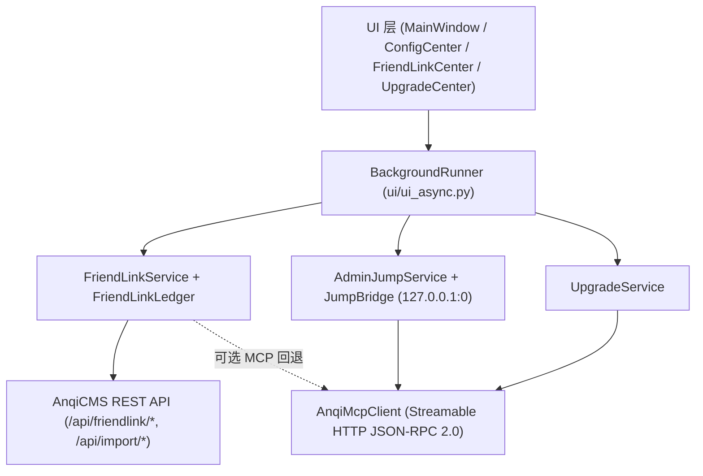

# AnqiCMS 站群管理扩展架构设计参考（2026-11-21）

本文档记录 **AnqiCMS 站群管理工具 v2.0.0** 站群扩展模块（MCP 协议客户端、友链管理与站群互链、后台一键直跳、版本检测与分批在线升级）的**实际落地架构与契约规范**。

---

## 1. 设计约束与个人自用存储策略

1. **零破坏向后兼容**：
   - 旧版 `config.ini` 在所有新字段为默认值时，加载并回写保持**精确一致的键集合（Byte-identical round-trip）**，新增配置项仅在非空或非默认值时条件落盘。
   - 主窗口 `MainWindow` 保持原有顶部选项卡（`["发布", "管理", "工具"]`）与下部内容选项卡（`["站点状态", "今日计划", "详情", "日志", "汇总"]`）不变；新功能通过「管理」工具栏新增按钮、站点列表右键菜单及独立 `Toplevel` 窗口承载。
   - 不新增任何第三方 Python 依赖，仅使用项目现有依赖（`requests`、标准库 `http.server`、`secrets`、`csv`、`concurrent.futures` 等），确保 PyInstaller 打包配置零改动。
2. **个人单机明文存储策略（无额外加密）**：
   - 本工具定位于个人单用户桌面环境，**不引入 DPAPI 或 `secret_store` 加密层**。
   - `mcp_token` 与 `admin_password` 与既有的 `jiekou` 导入接口地址一致，在 `config.ini` 中以**明文**按需保存（非空时写入）。
   - 内存实体字段设置 `repr=False`，UI 界面默认遮罩显示（`•` + 显示切换，`mask_secret` 输出 `未配置` / `已配置(****xxxx)`），日志与异常消息统一经 `core/redaction.py`（`SecretRedactor`）脱敏，避免 Token 与密码出现在日志或错误弹窗中。

---

## 2. 数据模型与持久化层

### 2.1 `SiteConfig` 扩展字段（`models/entities.py`）

在 `SiteConfig` 末尾（`image_groups_snapshot` 之后）追加以下字段：

```python
site_title: str = ""                              # 站点显示名 / 友链默认锚文本（空则回退至 name）
site_group: str = ""                              # 单值分组标签（≤64 字符，禁止换行与控制字符）
mcp_token: str = field(default="", repr=False)    # MCP Token（空则自动回退提取 jiekou 中的 import token）
admin_username: str = ""                          # 后台管理员账号
admin_password: str = field(default="", repr=False) # 后台管理员密码
admin_path: str = "/system/"                      # 后台入口路径（规范化为以 / 开头和结尾）
```

### 2.2 `config.ini` 条件持久化与校验（`core/config_service.py`、`core/site_factory.py`）

| INI 键名 | 写入条件 | 存储格式与校验规则 |
| :--- | :--- | :--- |
| `site_title` | 非空 | 明文字符串；禁止包含换行或控制字符 |
| `site_group` | 非空 | 明文字符串；长度 ≤ 64（`SITE_GROUP_MAX_LENGTH=64`），禁止控制字符 |
| `mcp_token` | 非空 | 明文字符串；禁止控制字符 |
| `admin_username` | 非空 | 明文字符串；禁止控制字符 |
| `admin_password` | 非空 | 明文字符串；禁止控制字符 |
| `admin_path` | 规范化后 ≠ `"/system/"` | 经 `normalize_admin_path` 校验，匹配 `^/[A-Za-z0-9._~\-/]*$`，拒绝 `..`、`//`、协议头或查询串 |

- **站点克隆策略（`clone_site_config`）**：仅复制 `site_group` 与 `admin_path`，不复制 `site_title`、`mcp_token`、`admin_username`、`admin_password`。
- **保留运行时文件**：`设置/friendlink_ledger.json`（互链台账）与 `设置/integration_settings.json`（集成高级参数）加入 `reserved_runtime_files` 冲突保护。

### 2.3 站点凭据与脱敏工具（`core/site_credentials.py`、`core/redaction.py`）

- `import_token(site)`：从 `site.jiekou` URL 查询参数中提取并解码 `token`。
- `effective_mcp_token(site)`：优先返回 `site.mcp_token`，未配置时自动回退至 `import_token(site)`。
- `admin_url(site)`：拼接 `site.url` 与规范化后的 `site.admin_path`。
- `site_origin_key(url)`：提取主机名（IDNA 小写、去除前缀 `www.` 与默认端口、忽略 `http/https` 协议差异），用于同源校验与自链识别。
- `SecretRedactor.from_sites(sites)`：收集所有站点的导入 Token、MCP Token 与后台密码，结合正则对 `Bearer`、`token=`、`password=`、`ticket=` 等敏感片段做统一替换为 `***`。

### 2.4 共享领域实体与集成配置（`models/sitegroup.py`、`core/integration_settings.py`）

- `models/sitegroup.py` 定义全部不可变结果契约（`@dataclass(frozen=True, slots=True)`）：
  - 友链与互链：`FriendLink`、`FriendLinkSpec`、`LinkOpResult`、`LinkHealth`、`CrossLinkItem`、`CrossLinkPlan`（含 `counts` 统计属性与 `fingerprint()` 预览一致性指纹）、`CrossLinkReport`、`LedgerEntry`、`LedgerPlanSummary`。
  - MCP 协议：`McpToolInfo`、`McpToolResult`、`McpProbeResult`。
  - 后台跳转：`JumpPlan`、`AdminJumpResult`。
  - 在线升级：`SiteVersionInfo`、`UpgradeProgress`、`UpgradeResult`。
- `core/integration_settings.py` 管理可选的 `设置/integration_settings.json`（含 `McpSettings`、`FriendLinkSettings`、`AdminJumpSettings`、`UpgradeSettings`），文件缺失或字段损坏时静默回退至安全默认值，绝不阻塞启动。

---

## 3. 核心服务层架构

所有核心服务遵循统一工程规范：**不依赖 Tkinter**、**禁止自动跟随携带 Token 的重定向（`allow_redirects=False`）**、**每个工作线程独立 `requests.Session`**、**所有异常与返回消息经过 `SecretRedactor` 脱敏**。



### 3.1 MCP 契约与客户端（`core/mcp_contracts.py`、`core/anqicms_mcp_client.py`）

- **协议传输**：实现 MCP Streamable HTTP（JSON-RPC 2.0），默认端点 `{site_url}/api/mcp`，请求头携带 `Authorization: Bearer <effective_mcp_token>`。
- **握手与版本协商**：`initialize()` 优先尝试 `2025-06-18`，若遇协议版本错误或 HTTP 400 自动回退尝试 `2025-03-26`、`2024-11-05`；记录服务端下发的 `Mcp-Session-Id` 并发送 `notifications/initialized`。
- **响应解析**：同时支持 `application/json` 单包响应与 `text/event-stream` 流式 SSE 事件流解析（忽略服务端通知，按 JSON-RPC `id` 匹配响应）。会话过期（携带 `Mcp-Session-Id` 收到 HTTP 404）时自动重新握手一次并重试。
- **动态工具发现（`score_tools`）**：支持 `nextCursor` 分页（上限 20 页）与实例级缓存；按「显式配置名称精确匹配 > 工具名命中关键词×3 + 描述命中关键词×1」打分排序，适配不同版本 AnqiCMS 的 MCP 工具命名。
- **错误分级与中文指引**：
  - `McpAuthError`（401/403/无 Token）：提示检查后台「设置 → 安全设置 / AI 统一配置」。
  - `McpScopeError`（工具返回权限/高危域未开启）：由 `classify_scope_error` 识别，提示在后台「AI 统一配置 → 接口开放范围」勾选对应权限。
  - `McpUnavailableError`（连接失败/超时/SSL 错误/3xx 重定向）：针对 3xx 提示修正 `http://` 与 `https://` 站点地址。
  - `probe_site()`：无异常探测站点 MCP 连通性，并自动归类该站可用的友链、升级、跳转工具列表。

### 3.2 友链管理与站群互链服务（`core/friendlink_service.py`、`core/friendlink_ledger.py`）

- **通信机制**：优先调用 AnqiCMS 官方 `/api/friendlink/list`、`/api/friendlink/create`、`/api/friendlink/delete`、`/api/friendlink/check` 接口（通过 Query `params={"token": import_token}` 鉴权，写操作采用 `multipart/form-data`），同时支持通过 `McpClientFactory` 协议回退。
- **规范化与去重**：`link_key(url)` 基于 `site_origin_key + path.rstrip('/')` 生成去重键（忽略 `http/https`、`www.`、末尾斜杠与默认端口）；自动拦截指向站点自身的自链（`skipped_self`）与已存在友链（`skipped_exists`）。
- **批量文本解析（`parse_batch_link_input`）**：支持 `标题|URL[|nofollow][|备注]`、`URL|标题`、Tab 分隔、中英文逗号分隔、空格分隔及纯 URL（自动提取域名为标题），忽略 `#` 注释行并按 `link_key` 去重，精确返回无效行号及原因。
- **站群互链拓扑（`plan_crosslink_items`）**：
  - **两两全互链（`mesh`）**：所有有序站点对互加友链，共 $n(n-1)$ 条。
  - **主从互链（`hub`）**：所有子站指向主站（$n-1$ 条）；勾选双向时主站同时指向所有子站（$2(n-1)$ 条）。
  - **轮链（`ring`）**：按选择顺序 $i \to (i+1) \bmod n$ 形成单向环（$n$ 条）；勾选双向时追加反向环（$2n$ 条，$n=2$ 时自动去重为 2 条）。
- **先预览后执行与台账回滚（`FriendLinkLedger`）**：
  - `preview_plan`（Dry-run）：按源站并发拉取一次现有友链列表，标记 `planned`、`skipped_exists` 或 `failed`。
  - `execute_plan`：按源站分组并发（默认上限 6）、单站内顺序写入并附带 `per_request_delay_s`（默认 0.2s），将实际新建成功的记录批量写入 `设置/friendlink_ledger.json`。
  - `rollback_plan`：**仅删除台账中状态为 `created` 且未回滚的友链**，绝不误删站点原有手工友链；若目标友链已被手工删除（`not_found`），同样标记为已回滚。台账文件损坏时自动隔离重命名为 `.corrupt-YYYYmmdd-HHMMSS` 并重建空台账。

### 3.3 三级后台跳转与本地回环桥（`core/admin_jump_service.py`、`core/jump_bridge.py`）

- **本地一次性跳转桥（`JumpBridge`）**：
  - 仅绑定 `127.0.0.1:0`（随机空闲端口），生成一次性路径 `/j/<token>`，默认有效期 60 秒，首次 `GET` 即销毁，空闲自动停止。
  - 校验 `Host: 127.0.0.1:{port}` 防护 DNS Rebinding，返回 `Cache-Control: no-store`、`Referrer-Policy: no-referrer`、`X-Content-Type-Options: nosniff` 及严格 CSP，确保任何临时凭据不出现在浏览器启动命令行参数或日志中。
- **三级降级跳转链（`AdminJumpService`）**：
  1. **Tier 1 — MCP 一次性票据（`ticket`）**：若站点可用 MCP 且暴露登录票据工具，调用工具获取同源跳转 URL 或票据，经 `JumpBridge` 302 跳转打开。
  2. **Tier 2 — 静默登录交接（`bridge`）**：若配置了 `admin_username` 与 `admin_password`，向 `{admin_url}api/login` 等路径校验账号密码，若配置了交接模板或自动表单提交则经 `JumpBridge` 免密进入。
  3. **Tier 3 — 直接打开后台登录页（`direct`）**：以上任一环节不满足或失败时，记录中文降级原因并直接调用浏览器打开 `{admin_url}`，保证**永不抛异常、100% 可达后台页面**。
- **批量打开保护（`open_many`）**：支持最大批量上限（默认 30）与间隔延迟（默认 400ms），超过确认阈值（默认 5 个）时先弹窗确认。

### 3.4 统一版本检测与分批在线升级（`core/upgrade_service.py`）

- **版本检测（`check_version` / `check_versions`）**：通过 MCP 动态查找版本/系统信息工具（如 `check_update`、`version`、`system_info` 等），由 `parse_version_payload` 解析结构化字段或文本版本号，通过 `compare_versions` 判断是否可升级，保持输入站点顺序返回 `SiteVersionInfo`。
- **单站升级生命周期（`upgrade_site`）**：
  1. 强制校验 `confirmed=True`（未确认直接抛出 `ValueError`）。
  2. `connecting` → `checking`：确认当前版本与最新版本；若已是最新则返回 `already_latest`。
  3. `upgrading`：匹配升级工具（自动排除仅含 `check/info/version` 的只读工具），注入目标版本及确认参数。若遇 `McpScopeError` 返回 `scope_disabled` 并附带后台开启「系统升级」高危域指引；若升级请求期间因站点重启导致连接断开或读取超时，视为进入重启阶段继续后续健康轮询。
  4. `restarting` → `verifying`（`wait_until_healthy`）：等待 `restart_wait_s` 后，按 `health_interval_s` 轮询站点首页可达性与最新 MCP 版本号（最长 `health_timeout_s`），确认版本号提升后标记 `upgraded`。
- **金丝雀与分批并发（`upgrade_sites`）**：
  - 默认开启 `canary_first=True`：**先单独升级第 1 个站点并验证健康恢复**。
  - 若首站失败且 `stop_on_failure=True`，立即中止后续批次，其余站点标记为 `skipped`，防止故障扩散。
  - 首站成功后，剩余站点按受控并发（1~5，默认 3）分批升级，支持 `cancel_event` 随时取消尚未开始的站点。

---

## 4. UI 架构与集成清单

| 模块文件 | 核心组件 | 职责说明 |
| :--- | :--- | :--- |
| `ui/ui_async.py` | `BackgroundRunner` | 后台守护线程执行器 + `SimpleQueue` + `widget.after()` 主线程回调派发；窗口销毁后自动丢弃回调 |
| `ui/site_picker.py` | `SitePicker` | 通用多站点选择器（复选框 Treeview、分组筛选下拉框、实时关键词搜索、全选/全不选/反选、行状态更新） |
| `ui/site_credentials_panel.py` | `SiteCredentialsFrame` | 配置中心与新建站点复用的「站群与后台」表单（分组、显示名、MCP Token、后台账号密码遮罩切换、后台路径、测试 MCP、跳转后台） |
| `ui/admin_jump_actions.py` | `open_admin_backends` | 后台跳转 UI 协调器（空选校验、批量超阈值确认、进度回调与汇总结果提示） |
| `ui/friendlink_center.py` | `FriendLinkCenter` | 友链中心独立窗口，内含 3 个选项卡：`单站友链`、`统一上下链`、`站群互链` |
| `ui/friendlink_batch_panel.py` | `FriendLinkBatchPanel` | 多站统一批量上链/下链面板（支持多格式文本解析预览、并发执行、停止与 `utf-8-sig` CSV 导出） |
| `ui/crosslink_panel.py` | `CrossLinkPanel` | 站群互链面板（全互链/主从/轮链、强制「先预览计划再执行」指纹校验、历史台账列表与一键回滚/解除互链） |
| `ui/upgrade_center.py` | `UpgradeCenter` | 统一升级中心窗口（批量检测版本、测试 MCP、并发数 1~5、金丝雀首站验证开关、失败即停开关、双击查看修复指引、运行中关闭保护） |
| `ui/main_window_sitegroup.py` | `SiteGroupActionsMixin` | 主窗口无侵入混入类：提供「管理」栏三大入口（`友链中心`、`统一升级`、`跳转后台`）及站点列表右键菜单（跳转后台/管理友链/检测版本/复制后台地址） |
| `ui/config_center.py` / `ui/new_site_dialog.py` | `ConfigCenter` / `NewSiteDialog` | 集成 `SiteCredentialsFrame` 与「站群信息（可选）」折叠区，支持未保存变更检测与草稿态即时测试 MCP / 跳转后台 |
